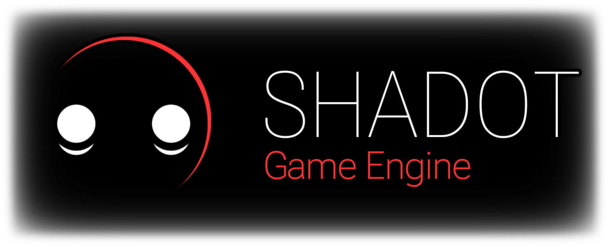

  

## A Toy [Godot](https://godotengine.org) Fork

(Notable features and changes are to be listed here, someday)

#### A Few Notes:
This repository and its maintainer ([Stayd](https://github.com/StaydMcMuffin)) are not in any way affiliated with either the Godot project or the [Godot Foundation](https://godot.foundation/). This is a personal fork, for personal use.

Likewise, none of the changes or additions contained within this repository are intended for upstream merging into mainline Godot.

While this project retains the same permissive [MIT license](https://godotengine.org/license) as mainline Godot, I (Stayd (that's me)) do not approve of, or consent to, any of my original code being used in commits or pull-requests for the main Godot repository without my knowledge and express prior approval.

I cannot stop anyone from doing so, but anyone who does, does so against my wishes.